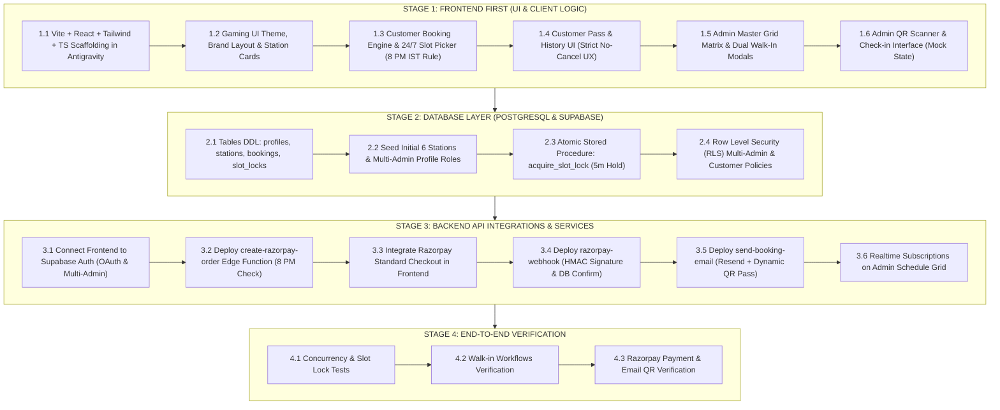

# Implementation Plan: Oliveal Gaming Zone Slot Booking Platform

> [!IMPORTANT]
> **PLANNING PHASE ONLY — PROJECT STATUS NOTICE**
> - This project is currently in the **PLANNING PHASE**.
> - **No application development has started.** No frontend or backend code has been scaffolded, no database tables have been created, no authentication has been configured, and no payment gateways or external services have been connected.
> - This document is the **central project requirements and implementation specification**, not a log of completed work.
> - **Development Environment:** All planning, architectural refinement, and future application development are conducted within **Antigravity**. Future development must strictly follow this finalized implementation plan.
> - **Execution Methodology:** We are strictly following a **3-Stage Sequential Build Approach**:
>   1. **Stage 1: Frontend First** (UI, client components, responsive dark theme, customer booking flow, admin operations grid, mock state).
>   2. **Stage 2: Database Layer** (PostgreSQL schema, tables, atomic 5-minute slot lock stored procedures, RLS security policies).
>   3. **Stage 3: Backend API Integration & Services** (Supabase Auth, Razorpay checkout & webhooks, Edge Functions, Resend QR emails).

---

## 1. Goal Description
Build a production-ready, full-stack slot reservation web application for **Oliveal Gaming Zone**. The system manages 6 dedicated stations (4 PS5s: `ALPHA`, `BETA`, `GAMMA`, `DELTA`; 2 Simulators: `RS1`, `RS2`) operating 24/7. It features customer booking with 60–120 minute durations, dynamic player pricing for PS5s, a 5-minute atomic checkout hold, online payment via Razorpay (compatible with individual/unregistered businesses without GSTIN), automated email confirmation with QR code verification, and a dedicated 24/7 Admin operations dashboard supporting multi-admin access, 1-click quick slot blocking, complete counter walk-in reservations, and QR check-ins.

```
┌────────────────────────────────────────────────────────────────────────┐
│                        OLIVEAL GAMING ZONE                             │
├───────────────────────────────────┬────────────────────────────────────┤
│           CUSTOMER APP            │            ADMIN PORTAL            │
│  - Station Picker (ALPHA-DELTA,   │  - Multi-Admin Access (Flat Roles) │
│    RS1, RS2)                      │  - 24/7 Master Grid Matrix (6 Rigs)│
│  - 24/7 Time Slot Picker          │  - Walk-in Workflow 1: Quick Block │
│  - 8:00 PM IST Tomorrow Unlock    │  - Walk-in Workflow 2: Full Booking│
│  - 5-Min Atomic Slot Hold         │  - Real-time Slot Availability     │
│  - Razorpay Checkout (UPI/Cards)  │  - Counter QR Scanner & Token Check│
│  - Strict No-Refund / No-Cancel   │  - Station Maintenance Toggle      │
│  - QR Code Ticket in App & Email  │                                    │
└─────────────────┬─────────────────┴──────────────────┬─────────────────┘
                  │                                    │
                  ▼                                    ▼
┌────────────────────────────────────────────────────────────────────────┐
│                      SUPABASE BACKEND & SERVICES                       │
│  - PostgreSQL DB with RLS & Stored Procedures (Atomic Slot Hold)       │
│  - Supabase Auth (Google OAuth & Email/Password, Multi-Admin Roles)    │
│  - Edge Functions: create-razorpay-order, razorpay-webhook, send-email │
│  - Resend Email Service (HTML Ticket + QR Code PNG)                   │
│  - Razorpay Gateway (Orders API + HMAC SHA256 Webhook Verification)    │
│  - Application Timezone: Asia/Kolkata (IST, UTC+05:30)                │
└────────────────────────────────────────────────────────────────────────┘
```

---

## 2. Confirmed Business & Architectural Requirements

### A. Booking Availability Rules (Confirmed: Option B)
*   **Today's Slots:** Customers can book available slots for the current day at any time (from the next available half-hour onward).
*   **Tomorrow's Slots (8:00 PM IST Rule):**
    *   Tomorrow's booking slots unlock at **exactly 8:00 PM (20:00) IST** (`Asia/Kolkata`).
    *   **Before 8:00 PM IST:** Tomorrow's calendar and slots must remain strictly unavailable and unbookable.
    *   **After 8:00 PM IST:** Customers can seamlessly view and book both today's remaining slots and tomorrow's complete 24-hour schedule.
*   **Dual Enforcement:** This rule is strictly enforced on **both frontend** (calendar UI disables tomorrow before 20:00 IST) and **backend** (`create-razorpay-order` Edge Function rejects requests for tomorrow if server timestamp in `Asia/Kolkata` is `< 20:00`).
*   **Booking Horizon:** No advance bookings are permitted beyond tomorrow.

### B. Cancellation and Refund Policy (Confirmed: Option A)
*   **Strict No Cancellation & No Refund Policy:**
    *   Customers **cannot** cancel confirmed bookings.
    *   Customers **cannot** request refunds through the application.
    *   **No customer cancellation or refund workflows/buttons** will be introduced in the customer portal or backend API.
*   **Failed & Expired Payments:**
    *   If a customer abandons checkout or payment fails, the 5-minute temporary slot hold automatically expires and releases the slot back to the public pool.
    *   No cancellation records are generated for abandoned holds.

### C. Admin Account Management (Confirmed: Option B)
*   **Multi-Admin Architecture:**
    *   The application supports **multiple administrator accounts**.
    *   **Flat Permission Model:** All administrators have **identical permissions**. There is no hierarchy (no Owner, Manager, or Staff sub-roles).
    *   Every administrator has unrestricted access to:
        1. View and manage all online and offline bookings across all dates.
        2. Execute both Walk-in workflows (Quick Block & Complete Booking).
        3. Toggle station availability and maintenance states.
        4. Perform QR code and token verification check-ins at the counter.
*   **Security & Authorization:**
    *   Admins authenticate via Supabase Auth (Email + Password).
    *   Role is identified in `public.profiles` with `role = 'admin'`.
    *   Supabase Row Level Security (RLS) policies grant equal full read/write access to any user whose profile has `role = 'admin'`.

### D. Walk-in Booking Management (Confirmed: Option C)
The Admin operations portal supports **two distinct offline workflows**, both running through the identical station conflict-detection engine:

*   **Workflow 1: Quick Slot Blocking (Fast POS)**
    *   *Purpose:* Instantly reserve a station when a customer walks in and starts playing immediately, without slowing down front-desk operations.
    *   *Inputs:* Station, Date, Start Time, Duration (60, 90, or 120 mins).
    *   *Customer Info:* **Optional / Not mandatory** (can be left blank).
    *   *System Action:* Creates a booking with `booking_type = 'walkin_quick_block'`, `payment_status = 'cash_counter'`, `booking_status = 'blocked_walkin'`.
    *   *Result:* Slot is instantly locked and unavailable to online customers.

*   **Workflow 2: Complete Walk-in Booking (Full Counter Order)**
    *   *Purpose:* Standard counter booking where customer details and cash accounting are tracked.
    *   *Inputs:* Customer Full Name, Phone Number, Station, Date, Start Time, Duration (60, 90, or 120 mins), and Player Count (1 or 2 for PS5).
    *   *Pricing:* Automatically calculated using the exact same pricing rules as online bookings.
    *   *Payment:* Recorded as cash received at counter (`payment_status = 'cash_counter'`).
    *   *System Action:* Creates a complete booking record with `booking_type = 'walkin_complete'`, `booking_status = 'confirmed'`, linked to cash payment.
    *   *Result:* Slot is reserved in the central system, unavailable to online users, and appears in the daily revenue reports.

---

## 3. Station Inventory & Pricing Specification

### Inventory
*   **4x PlayStation 5 Stations:** Named `ALPHA`, `BETA`, `GAMMA`, `DELTA` (Max 2 players per station).
*   **2x Racing Simulators:** Named `RS1`, `RS2` (1 player per station).
*   **Operating Hours:** 24/7 continuous operations.
*   **Buffer Time:** Zero buffer between slots (e.g., 14:00–15:00 immediately followed by 15:00–16:00).
*   **Allowed Durations:** Strictly **60 minutes**, **90 minutes**, or **120 minutes** (all start on 30-minute intervals).

### Pricing Table (Standardized across Online & Walk-in)
| Station Type | Player Count | 60 mins | 90 mins | 120 mins (Max) |
| :--- | :--- | :--- | :--- | :--- |
| **PS5** (`ALPHA` to `DELTA`) | 1 Player | ₹150 | ₹225 | ₹300 |
| **PS5** (`ALPHA` to `DELTA`) | 2 Players | ₹200 | ₹300 | ₹400 |
| **Simulator** (`RS1`, `RS2`)| 1 Player | ₹200 | ₹300 | ₹400 |

---

## 4. Proposed Database Schema (Supabase / PostgreSQL)

The schema supports multi-admin access, online & walk-in bookings, atomic slot holds, and strict RLS policies.

### Tables

#### `public.profiles`
*   `id` (UUID, PK, references `auth.users.id` ON DELETE CASCADE)
*   `full_name` (TEXT)
*   `email` (TEXT UNIQUE)
*   `phone` (TEXT)
*   `role` (TEXT NOT NULL DEFAULT `'customer'`, CHECK `role IN ('customer', 'admin')`)
*   `created_at` (TIMESTAMPTZ DEFAULT `now()`)

#### `public.stations`
*   `id` (UUID, PK DEFAULT `gen_random_uuid()`)
*   `name` (TEXT UNIQUE NOT NULL) — `'ALPHA'`, `'BETA'`, `'GAMMA'`, `'DELTA'`, `'RS1'`, `'RS2'`
*   `type` (TEXT NOT NULL, CHECK `type IN ('ps5', 'simulator')`)
*   `max_players` (INT NOT NULL) — 2 for PS5, 1 for Simulator
*   `hourly_rate_1p` (INT NOT NULL) — 150 for PS5, 200 for RS
*   `hourly_rate_2p` (INT) — 200 for PS5, NULL for RS
*   `is_active` (BOOLEAN NOT NULL DEFAULT `true`)
*   `created_at` (TIMESTAMPTZ DEFAULT `now()`)

#### `public.bookings`
*   `id` (UUID, PK DEFAULT `gen_random_uuid()`)
*   `booking_code` (TEXT UNIQUE NOT NULL) — e.g., `OLV-261103-A89F`
*   `booking_type` (TEXT NOT NULL DEFAULT `'online'`, CHECK `booking_type IN ('online', 'walkin_complete', 'walkin_quick_block')`)
*   `user_id` (UUID REFERENCES `public.profiles.id`, nullable for walk-ins)
*   `customer_name` (TEXT) — Populated for online users or Walk-in Workflow 2
*   `customer_phone` (TEXT) — Populated for online users or Walk-in Workflow 2
*   `station_id` (UUID NOT NULL REFERENCES `public.stations.id`)
*   `booking_date` (DATE NOT NULL)
*   `start_time` (TIME NOT NULL)
*   `end_time` (TIME NOT NULL)
*   `duration_minutes` (INT NOT NULL, CHECK `duration_minutes IN (60, 90, 120)`)
*   `player_count` (INT NOT NULL DEFAULT 1, CHECK `player_count IN (1, 2)`)
*   `total_amount` (INT NOT NULL)
*   `payment_status` (TEXT NOT NULL, CHECK `payment_status IN ('pending', 'paid', 'cash_counter', 'failed')`)
*   `payment_method` (TEXT NOT NULL DEFAULT `'razorpay'`, CHECK `payment_method IN ('razorpay', 'cash', 'none')`)
*   `booking_status` (TEXT NOT NULL DEFAULT `'confirmed'`, CHECK `booking_status IN ('confirmed', 'checked_in', 'blocked_walkin')`)
*   `razorpay_order_id` (TEXT)
*   `razorpay_payment_id` (TEXT)
*   `verification_token` (UUID DEFAULT `gen_random_uuid()`)
*   `created_by_admin_id` (UUID REFERENCES `public.profiles.id`) — Tracks which admin executed walk-in
*   `created_at` (TIMESTAMPTZ DEFAULT `now()`)

#### `public.slot_locks`
*   `id` (UUID, PK DEFAULT `gen_random_uuid()`)
*   `station_id` (UUID NOT NULL REFERENCES `public.stations.id`)
*   `booking_date` (DATE NOT NULL)
*   `start_time` (TIME NOT NULL)
*   `end_time` (TIME NOT NULL)
*   `user_id` (UUID REFERENCES `public.profiles.id`)
*   `locked_until` (TIMESTAMPTZ NOT NULL) — `now() + interval '5 minutes'`
*   `created_at` (TIMESTAMPTZ DEFAULT `now()`)

### Database Stored Procedure: Atomic Slot Hold
```sql
CREATE OR REPLACE FUNCTION public.acquire_slot_lock(
    p_station_id UUID,
    p_date DATE,
    p_start_time TIME,
    p_end_time TIME,
    p_user_id UUID
) RETURNS JSONB
LANGUAGE plpgsql
SECURITY DEFINER
AS $$
DECLARE
    v_conflict_booking BOOLEAN;
    v_conflict_lock BOOLEAN;
    v_lock_id UUID;
BEGIN
    -- 1. Check existing confirmed or walk-in bookings
    SELECT EXISTS (
        SELECT 1 FROM public.bookings
        WHERE station_id = p_station_id
          AND booking_date = p_date
          AND payment_status IN ('paid', 'cash_counter')
          AND (start_time, end_time) OVERLAPS (p_start_time, p_end_time)
    ) INTO v_conflict_booking;

    IF v_conflict_booking THEN
        RETURN jsonb_build_object('success', false, 'reason', 'Slot is already booked');
    END IF;

    -- 2. Check active 5-minute checkout holds from other users
    SELECT EXISTS (
        SELECT 1 FROM public.slot_locks
        WHERE station_id = p_station_id
          AND booking_date = p_date
          AND locked_until > now()
          AND (user_id IS NULL OR user_id != p_user_id)
          AND (start_time, end_time) OVERLAPS (p_start_time, p_end_time)
    ) INTO v_conflict_lock;

    IF v_conflict_lock THEN
        RETURN jsonb_build_object('success', false, 'reason', 'Slot is currently held by another customer');
    END IF;

    -- 3. Clear any expired locks for this slot
    DELETE FROM public.slot_locks
    WHERE station_id = p_station_id
      AND booking_date = p_date
      AND locked_until <= now();

    -- 4. Insert new 5-minute lock
    INSERT INTO public.slot_locks (station_id, booking_date, start_time, end_time, user_id, locked_until)
    VALUES (p_station_id, p_date, p_start_time, p_end_time, p_user_id, now() + interval '5 minutes')
    RETURNING id INTO v_lock_id;

    RETURN jsonb_build_object('success', true, 'lock_id', v_lock_id, 'locked_until', now() + interval '5 minutes');
END;
$$;
```

### Row Level Security (RLS) Policy Architecture
*   **Admins (Equal Access for All Admins):**
    *   Helper function: `public.is_admin()` checks if `auth.uid()` has `role = 'admin'` in `public.profiles`.
    *   Admins have full `SELECT`, `INSERT`, `UPDATE`, `DELETE` permissions on `bookings`, `stations`, and `slot_locks`.
*   **Customers:**
    *   Can `SELECT` active stations.
    *   Can `SELECT` bookings where `user_id = auth.uid()`.
    *   Cannot view other customers' personal details (only slot occupancy intervals via availability views).
    *   Cannot modify or delete confirmed bookings (enforcing strict no-cancellation policy).

---

## 5. Backend Serverless Architecture (Supabase Edge Functions)

### 1. `create-razorpay-order`
*   **Input:** `station_id`, `date`, `start_time`, `duration_minutes`, `player_count`.
*   **Enforcements:**
    *   Verifies user authentication.
    *   Validates `duration_minutes` is strictly `60`, `90`, or `120`.
    *   Enforces the **8:00 PM IST Rule**:
        ```typescript
        const nowIST = new Date(new Date().toLocaleString("en-US", { timeZone: "Asia/Kolkata" }));
        const isTomorrow = isSameDay(targetDate, addDays(nowIST, 1));
        if (isTomorrow && nowIST.getHours() < 20) {
            return new Response(JSON.stringify({ error: "Tomorrow's slots unlock at 8:00 PM IST" }), { status: 400 });
        }
        ```
    *   Calculates price server-side (₹150/₹200/hr for PS5; ₹200/hr for Simulators).
    *   Executes `acquire_slot_lock` RPC.
    *   Creates Razorpay Order via Razorpay REST API (paise amount, currency `INR`).
    *   Inserts preliminary booking with `payment_status = 'pending'`.
    *   Returns `order_id`, `amount`, `key_id`, and `locked_until`.

### 2. `razorpay-webhook`
*   **Security:** Computes HMAC SHA-256 signature using `RAZORPAY_WEBHOOK_SECRET` and compares with `x-razorpay-signature`.
*   **On `order.paid` / `payment.captured`:**
    *   Updates `bookings` record: `payment_status = 'paid'`, `booking_status = 'confirmed'`, saves `razorpay_payment_id`.
    *   Removes entry from `slot_locks`.
    *   Asynchronously invokes `send-booking-email`.

### 3. `send-booking-email`
*   Generates QR code embedding `verification_token` and `booking_code`.
*   Sends confirmation email via Resend API with Oliveal Gaming Zone branding, slot details, station name, and attached/embedded QR code.

---

## 6. Frontend Architecture (React + Vite + Tailwind CSS + TypeScript)

```
src/
├── assets/                          # Gaming graphics, station photos, brand logos
├── components/
│   ├── booking/
│   │   ├── StationPicker.tsx         # ALPHA, BETA, GAMMA, DELTA, RS1, RS2 selector
│   │   ├── TimeSlotPicker.tsx        # 24-hr visual slot grid with 8:00 PM IST rule
│   │   ├── DurationSelector.tsx      # 60 min, 90 min, 120 min pills
│   │   ├── PlayerCountSelector.tsx   # 1 or 2 players toggle (PS5 only)
│   │   ├── SlotLockCountdown.tsx     # 5:00 active lock countdown timer
│   │   └── CheckoutModal.tsx         # Razorpay checkout trigger & summary
│   ├── admin/
│   │   ├── MatrixScheduleGrid.tsx    # 24-hr master grid for all 6 stations
│   │   ├── WalkInQuickBlockModal.tsx # Workflow 1: Instant slot block (no info req.)
│   │   ├── WalkInCompleteModal.tsx   # Workflow 2: Full walk-in (Name, Phone, Cash)
│   │   ├── QRScannerModal.tsx        # Camera QR scanner & manual token search
│   │   └── StationStatusToggle.tsx   # Maintenance mode toggle
│   ├── common/
│   │   ├── Navbar.tsx                # Navigation, brand identity, user profile
│   │   ├── ProtectedRoute.tsx        # Customer and Admin route guards
│   │   └── StatusBadge.tsx
├── context/
│   └── AuthContext.tsx               # Supabase Auth, Google OAuth, Multi-admin check
├── hooks/
│   ├── useStations.ts                # Station data and maintenance states
│   └── useSlotAvailability.ts        # Real-time slot availability & lock monitoring
├── lib/
│   ├── supabase.ts                   # Supabase client setup
│   ├── razorpay.ts                   # Razorpay Standard Checkout SDK loader
│   └── dateUtils.ts                  # Asia/Kolkata timezone helpers & 8 PM unlocker
├── pages/
│   ├── Home.tsx                      # Landing page, station specs, booking widget
│   ├── MyBookings.tsx                # Customer booking history & live QR passes
│   ├── Login.tsx                     # Google OAuth + Email/Password
│   ├── Register.tsx                  # Customer account creation
│   └── admin/
│       ├── AdminDashboard.tsx        # Master real-time operations matrix
│       └── AdminBookingsList.tsx     # Filterable list of all orders & walk-ins
├── types/
│   └── index.ts                      # Full TypeScript interfaces
└── App.tsx                           # Routing & layout wrapper
```

---

## 7. Step-by-Step Implementation Sequence: Sequential Build Order

We follow the confirmed **Frontend First ➔ Database Layer ➔ Backend API Integration** workflow:



### Stage 1: Frontend First (UI, Components & Client Logic)
*   **Step 1.1:** Scaffold React + Vite + TypeScript + Tailwind CSS inside Antigravity.
*   **Step 1.2:** Implement dark gaming theme (slate-950 background, neon purple/cyan accents, Lucide icons, station cards for `ALPHA`, `BETA`, `GAMMA`, `DELTA`, `RS1`, `RS2`).
*   **Step 1.3:** Build Customer Booking Flow:
    *   Date selector enforcing today and tomorrow (locked before 8:00 PM IST).
    *   24-hour visual time slot matrix (48 half-hour blocks per day).
    *   Duration selector (60, 90, 120 mins).
    *   Player count selector (1 or 2 players for PS5; fixed 1 for Simulators).
    *   Price calculation preview and 5-minute checkout countdown hold modal.
*   **Step 1.4:** Build Customer Dashboard & QR Pass:
    *   Active bookings card with ticket details and dynamic QR display.
    *   Past booking history.
    *   Strict absence of any customer cancellation or refund options.
*   **Step 1.5:** Build Admin 24/7 Schedule Matrix & Dual Walk-In UI:
    *   Interactive 24-hour grid of all 6 stations with color-coded slots.
    *   **Workflow 1 Modal (Quick Slot Block):** Instant 1-click station blocking without requiring customer info.
    *   **Workflow 2 Modal (Complete Walk-in):** Full form capturing Customer Name, Phone, Duration, and calculating Cash amount.
    *   Station maintenance mode toggle.
*   **Step 1.6:** Build Admin QR Scanner Interface (camera scanner & manual token search).
*   *Validation of Stage 1:* Complete end-to-end UI walkthrough using mock state to verify layout, responsiveness, and UX before touching database.

### Stage 2: Database Layer (PostgreSQL & Supabase DDL)
*   **Step 2.1:** Execute DDL migrations for `public.profiles`, `public.stations`, `public.bookings`, `public.slot_locks`.
*   **Step 2.2:** Seed the 6 default stations (`ALPHA`, `BETA`, `GAMMA`, `DELTA`, `RS1`, `RS2`) and insert initial admin profile records.
*   **Step 2.3:** Implement the `acquire_slot_lock` PostgreSQL stored procedure to provide atomic 5-minute checkout holds and eliminate double-booking race conditions.
*   **Step 2.4:** Implement Row Level Security (RLS) policies:
    *   Equal unrestricted access across all tables for all users where `role = 'admin'`.
    *   Customer read access to active stations and their own bookings (`user_id = auth.uid()`).
    *   No public update or delete permissions on confirmed bookings.

### Stage 3: Backend API Integrations & Services
*   **Step 3.1:** Connect Frontend to Supabase Client & Auth (Google OAuth + Email/Password with multi-admin role verification).
*   **Step 3.2:** Deploy `create-razorpay-order` Edge Function:
    *   Server-side validation of 8:00 PM IST tomorrow unlock rule.
    *   Server-side price calculation.
    *   Calls `acquire_slot_lock` stored procedure.
    *   Calls Razorpay Orders API (supports unregistered/individual accounts without GSTIN).
*   **Step 3.3:** Integrate Razorpay Standard Checkout in frontend and handle payment responses.
*   **Step 3.4:** Deploy `razorpay-webhook` Edge Function:
    *   HMAC SHA-256 signature verification.
    *   Updates booking to `paid` and `confirmed`.
    *   Clears expired/consumed slot locks.
*   **Step 3.5:** Deploy `send-booking-email` Edge Function:
    *   Generates QR code PNG using `qrcode` library.
    *   Sends confirmation email via Resend API.
*   **Step 3.6:** Wire up Supabase Realtime subscriptions so Admin grid and Customer booking screens reflect slot holds and bookings dynamically.

### Stage 4: End-to-End Verification & Production Readiness
*   Full integration testing across concurrency, dual walk-in workflows, payment capture, and QR check-in.

---

## 8. Verification & Testing Plan

### Automated Tests
1. **Pricing Engine Tests:**
   - PS5 1-Player: 60m = ₹150, 90m = ₹225, 120m = ₹300.
   - PS5 2-Players: 60m = ₹200, 90m = ₹300, 120m = ₹400.
   - Simulator: 60m = ₹200, 90m = ₹300, 120m = ₹400.
2. **Availability & Timezone Rules:**
   - Attempting to book tomorrow at 19:59 IST is rejected with `400 Bad Request`.
   - Attempting to book tomorrow at 20:00 IST succeeds.
   - Attempting to book < 60 minutes or > 120 minutes is rejected.
3. **Concurrency & Lock Mechanics:**
   - Simultaneous hold requests for the same station/slot result in 1 success and 1 conflict (`409 Conflict`).
   - Expired holds (> 5 mins) automatically allow new holds.

### Manual Verification (Aligned with Stage Sequence)
1. **Frontend-First UX Verification (Stage 1):**
   - Verify responsive navigation on desktop and mobile.
   - Verify 8:00 PM IST tomorrow unlock toggle behavior on the UI.
   - Verify both Walk-in modals (Quick Block vs Complete Walk-in) render correctly on the Admin matrix.
2. **Database & Lock Verification (Stage 2):**
   - Verify `acquire_slot_lock` prevents overlapping intervals and releases expired locks after 300 seconds.
   - Verify RLS policies block customer access to other customers' data while granting all admins full access.
3. **Full Integration Verification (Stage 3):**
   - Customer test checkout via Razorpay Standard Checkout.
   - Confirmation email delivery with QR code.
   - Admin counter QR scanning and status update to `Checked-In`.
   - Admin walk-in creation updating both Admin grid and Customer availability in real time.

---

## 9. Open Questions & Assumptions

### Assumptions
*   **ASSUMPTION 1 (Slot Alignment):** All slots must align to 30-minute marks (e.g., 14:00, 14:30).
*   **ASSUMPTION 2 (Email Gateway):** Resend will be used for transactional confirmation emails.
*   **ASSUMPTION 3 (Cash Counter Accounting):** Walk-in cash payments are recorded upon booking creation by the logged-in admin on duty.

### Open Questions
*   None blocking architectural planning.
